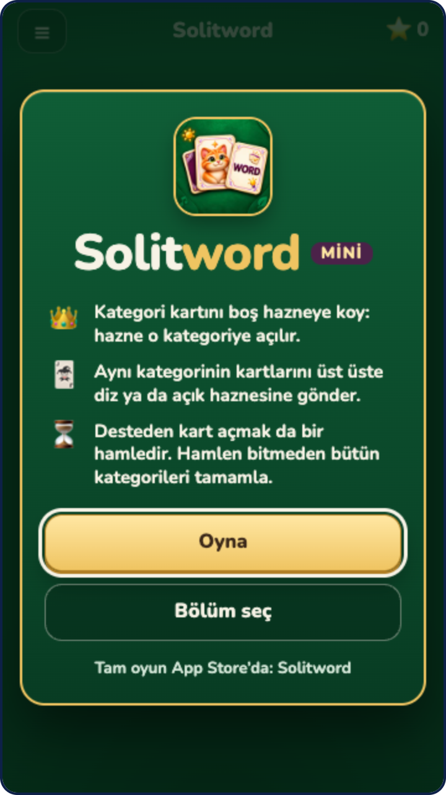
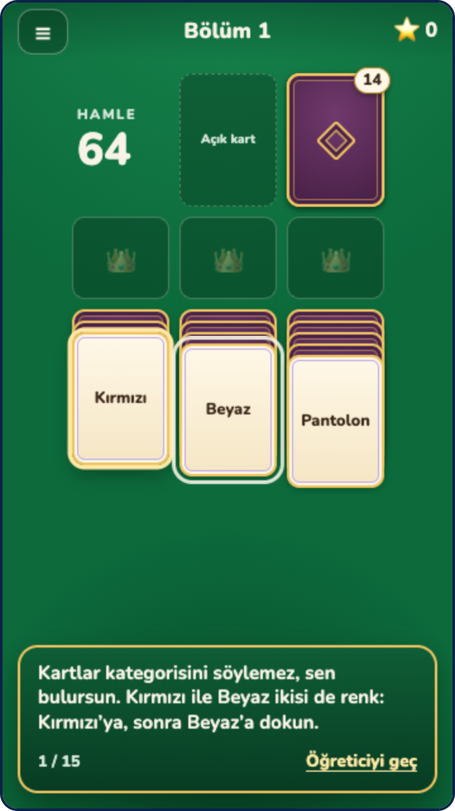
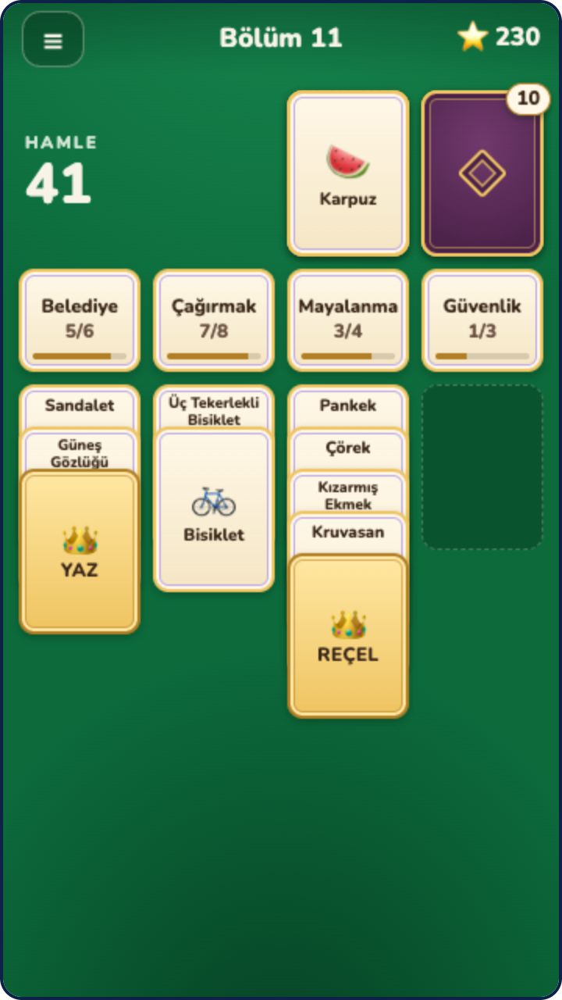

# Solitword Mini

Made with the [Kampüse Games Kit](https://github.com/kampuseapp/games-kit).

**Players:** 1 (solo)
**Language:** Turkish

### The game

A card-sorting word puzzle. Every card belongs to a category, but the cards do not say which. A category's header
card opens an empty bin for it; that category's cards are then delivered there. Cards stack only on their own
category, a stack moves as one block, and every draw, stack and delivery costs a move. Complete every category
before the moves run out.

Twenty levels, from a small table with four categories to a large one with twelve. The first level opens with a
short lesson that points out each move; it can be skipped. One level is one round: its
score is 10 points for every card delivered, plus 5 for every move left over on a win.

### Screenshots

    

    

    

### Licence

This game is not under the repository's MIT licence: see [LICENSE.md](LICENSE.md). The font in `fonts/` is Nunito,
under the SIL Open Font License (`fonts/OFL.txt`).
